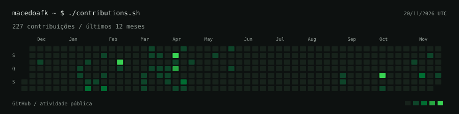
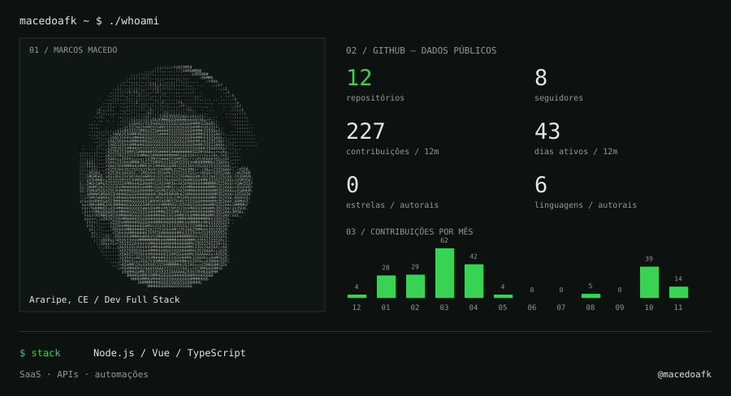

```sh
$ whoami
Marcos Macedo / @macedoafk
Dev Full Stack em formação · ADS · Araripe, CE
Node.js · Vue · TypeScript / SaaS, APIs e automações
```

### `$ ls projetos/`

**[pix-brcode](https://github.com/macedoafk/pix-brcode)** — Gera, lê e valida Pix copia-e-cola e QR Code. TypeScript, zero dependências.

```sh
npm i @m4rquin/pix-brcode
```

[npm](https://www.npmjs.com/~m4rquin) · [LinkedIn](https://www.linkedin.com/in/antonio-marcos-9305bb2b4/) · [Repositórios](https://github.com/macedoafk?tab=repositories)

<sub>Painéis gerados com dados públicos do GitHub; data da coleta no calendário.</sub>
