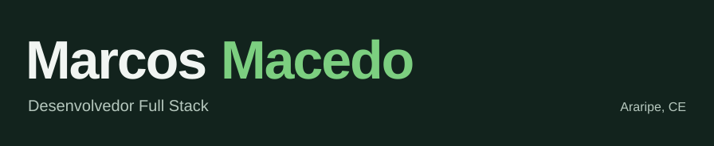

Desenvolvo aplicações web, APIs e automações com **Node.js, Vue e TypeScript**. Estudo Análise e Desenvolvimento de Sistemas e sou de Araripe, no Ceará.

[LinkedIn](https://www.linkedin.com/in/antonio-marcos-9305bb2b4/) · [Pacotes no npm](https://www.npmjs.com/~m4rquin) · [Repositórios](https://github.com/marcedoafk?tab=repositories)

## pix-brcode

Biblioteca TypeScript para **gerar, ler e validar Pix copia-e-cola**, com geração de QR Code em SVG. Funciona em Node.js e no navegador, sem dependências.

```sh
npm install @m4rquin/pix-brcode
```

`generate` cria o código · `parse` lê os campos · `validate` verifica o CRC · `qrSvg` gera o QR Code.

[Abrir o código](https://github.com/marcedoafk/pix-brcode) · [Ver o pacote no npm](https://www.npmjs.com/package/@m4rquin/pix-brcode)

## Tecnologias

- **Aplicações web** — Vue, JavaScript e TypeScript.
- **APIs e integrações** — Node.js, Fastify e Express.
- **Infraestrutura** — Docker, Linux e Nginx.
